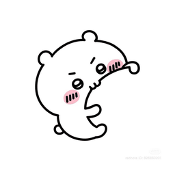
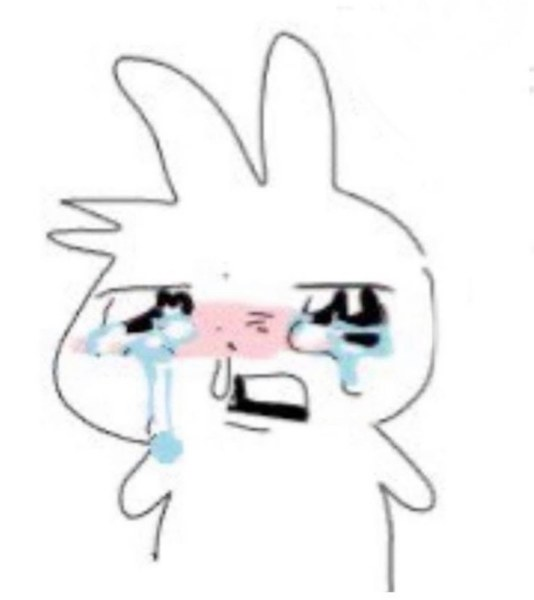
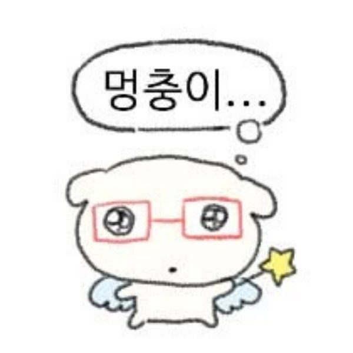
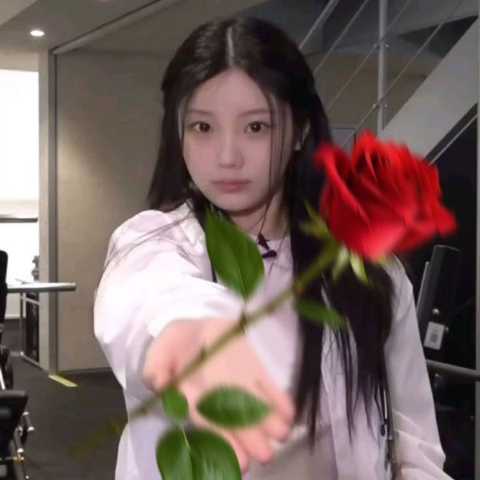
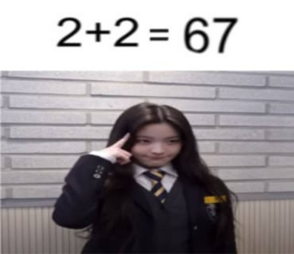
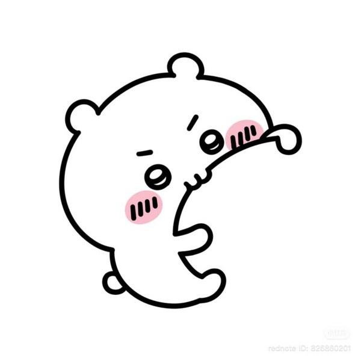
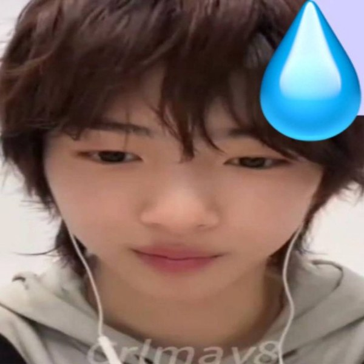
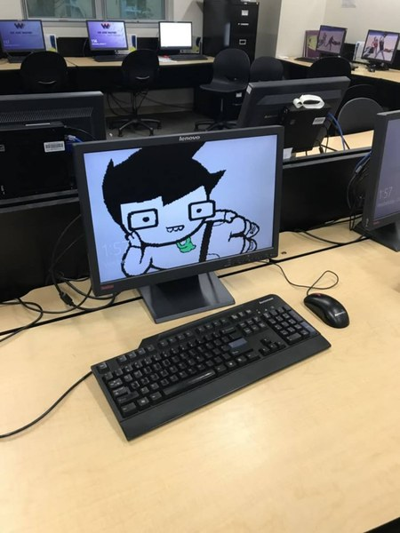

｡･ﾟ･｡+☆+｡･ﾟ･｡+☆+｡･ﾟ･｡

<table>
  <tr>
    <td width="34%" align="center" valign="middle">
      
    </td>
    <td width="66%" valign="middle">
      <h2>Zyn - Second account</h2>
      <blockquote>Here you'll find Zyn's side projects</blockquote>
      
˚₊‧꒰ა☆໒꒱‧₊˚ A small corner for code, experiments, and ideas.

    </td>
  </tr>
</table>

### about me (ﾉ´ヮ´)ﾉ*:･ﾟ✧

Hi, I'm **Zyn**! I enjoy building things, learning new technologies, and turning random ideas into projects.

**my experience** · *Write about your programming experience here. Which languages, tools, or projects have you worked on?*

**currently working on** · *Add your current side projects or what you're learning.*

### little things i like ˚₊‧꒰ა☆໒꒱‧₊˚

`coding` · `LÖVE2D` · `game development` · `minimal design` · `cute stickers`

  
  &nbsp;
  
  &nbsp;
  

  
more little stickers ♡

  

    
    
    
    
  

(⁠~⁠￣⁠³⁠￣⁠)⁠~

