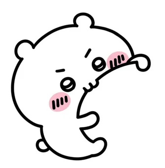
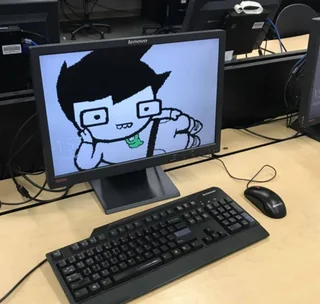
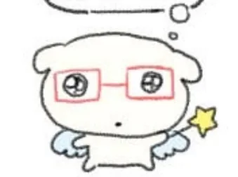
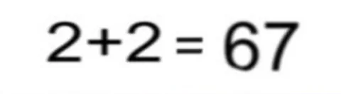
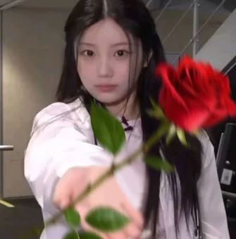
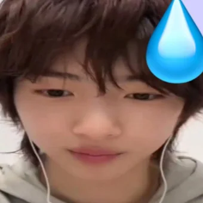
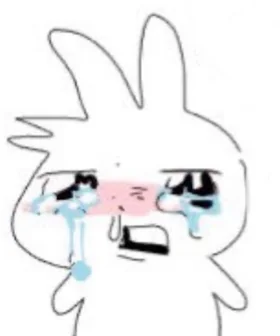

｡･ﾟ･｡+☆+｡･ﾟ･｡+☆+｡･ﾟ･｡

### Zyn - Second account

> Here you'll find Zyn's side projects

**˚₊‧꒰ა☆໒꒱‧₊˚** A little space for ideas, experiments and everything in between.

 

---

### 01 / about me (ﾉ´ヮ´)ﾉ*:･ﾟ✧

Hi! I'm **Zyn**, a developer from Peru who enjoys making things just to see if they can work. I spend most of my time exploring game development, web interfaces and creative coding.

I like projects that are **simple to use, thoughtfully designed and fun to build**. This is my second account, where smaller ideas get their own space.

 

### 02 / my experience

I learn by building, testing and improving. My experience is mostly with **LÖVE2D projects, game engines, web apps and command-line tools**.

- **Game development:** gameplay systems, mods and experiments with Lua.
- **Web development:** interfaces and backends with JavaScript, TypeScript and Node.js.
- **Other experiments:** Python tools and little automation projects.

*Currently exploring:* **Python**.

 

### 03 / languages & tools

**Languages**  
`Lua` · `JavaScript` · `TypeScript` · `Python` · `HTML` · `CSS`

**Things I use**  
`LÖVE2D` · `Node.js` · `Git` · `Termux` · `Vercel`

**Want to learn next**  
`Rust` and `C++`

 

### 04 / side projects, little experiments

Not every idea needs to be a big project. Some are just interesting enough to try. (⁠~⁠￣⁠³⁠￣⁠)⁠~

- **Games & mechanics** · small prototypes and rhythm-game ideas.
- **Developer tools** · useful scripts, CLIs and experiments.
- **UI concepts** · clean layouts, animations and tiny details.

*Featured project:* **Light Engine** · It's on my main account. It's a custom engine from Friday Night Funkin'. Maybe one of my future projects will beat this one.

 

### 05 / things i like ♡

`games` · `creative coding` · `minimal design` · `music` · `animations`

I have a soft spot for interfaces that feel cozy without being cluttered, and for small visual details that give a project a little personality.

*Other favorites:* **Russian music, anime, K-dramas, and I ran out of ideas**...

 

### 06 / life lately

A bit of coding, a bit of learning, and probably one more bug to fix. I'm always finding new things to explore, even outside programming.

*Currently:* **With some help from AI I can accomplish these projects. My life is somewhat complicated financially and I'm only a first-year high school student**.

 

---

  
   
  thanks for stopping by ♡ · see you around!
   
  ｡･ﾟ･｡+☆+｡･ﾟ･｡+☆+｡･ﾟ･｡

